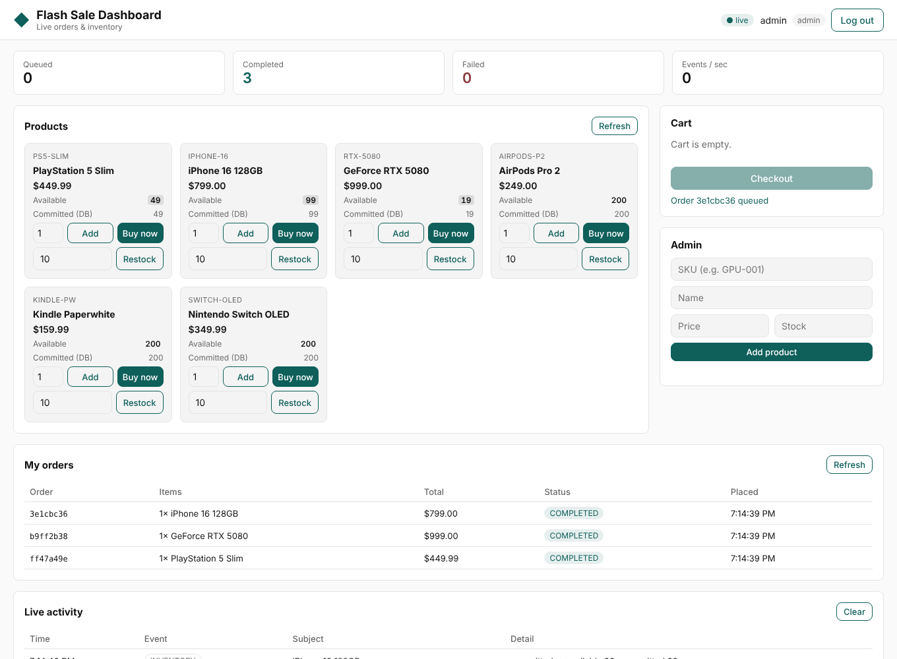
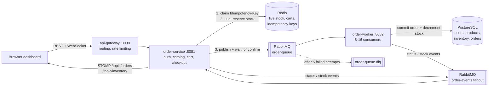
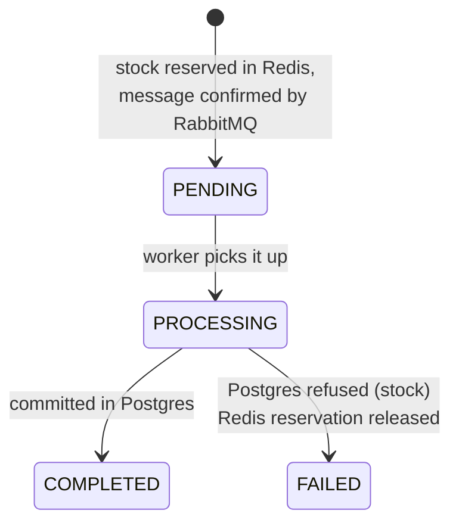

# Distributed Real-Time Order & Inventory Tracking System

A flash-sale backend that takes thousands of concurrent checkouts for limited stock
**without overselling**, processes orders asynchronously through RabbitMQ, and pushes
live order status and stock levels to a dashboard over WebSockets.

Built with Java 21, Spring Boot 3.5, Redis, RabbitMQ, PostgreSQL and Spring Cloud Gateway.



## Results at a glance

| What was tested | Result |
|---|---|
| 1,000 buyers hit checkout at the same instant for 500 units (k6) | **exactly 500 accepted, 500 sold out, 0 errors** |
| Stock after the sale | Redis `0`, Postgres `0`. Nothing oversold, both stores agree |
| Same request retried with the same `Idempotency-Key` | same order returned, no second order or charge |
| Postgres stopped during live traffic | catalog served from Redis, checkouts still accepted, orders complete once the DB is back |
| 60 login attempts in a burst from one IP | 40 pass, 20 get `429 Too Many Requests` |
| Automated tests | 18 integration tests against real Postgres / Redis / RabbitMQ (Testcontainers) |

Latency: p95 ≈ 2.6 s for 1,000 simultaneous checkouts. That was measured on one 4-vCPU
machine running everything at once: k6, gateway, API, worker, Postgres, Redis and
RabbitMQ. The CPU was at 100%, so that number is a hardware ceiling, not a design limit.
Most of the wait is queueing behind the spike.

## Architecture



### What happens on checkout

1. **Idempotency.** `SET NX` on `idem:{user}:{key}` claims the request. A retry with the
   same key gets the original answer. Reusing a key with a different cart is rejected
   with `422`.
2. **Reserve stock atomically.** One Lua script checks *every* line of the order, then
   decrements *every* line. Redis runs scripts one at a time, so two buyers can never
   both take the last unit. A multi-item order is all-or-nothing.
3. **Queue it.** The order goes to `order-queue` with a publisher confirm, so a `202
   Accepted` means the message is on disk in RabbitMQ. If publishing fails, the
   reservation is released and the client gets `503` and can retry with the same key.
4. **Respond.** `202 Accepted` with an `orderId` and a status URL. Postgres has not been
   touched yet.
5. **Worker commits.** In one transaction it inserts the order and runs
   `UPDATE inventory SET quantity = quantity - ? WHERE product_id = ? AND quantity >= ?`
   for each line, locking rows in product-id order so two orders can't deadlock. Then
   it marks the order `COMPLETED`.
6. **Live updates.** Every step (PENDING → PROCESSING → COMPLETED / FAILED, plus stock
   changes) goes out on a fanout exchange. Each API instance relays it to its WebSocket
   clients.

### Order status flow



## Design decisions (and where I went beyond the brief)

The brief suggested a general approach. These are the choices I made and why.

| Decision | Why |
|---|---|
| **Checkout touches only Redis + RabbitMQ.** Prices come from a Redis product snapshot too | The hot path never waits on Postgres, so a slow or down database can't take checkout down with it |
| **Lua script instead of a distributed lock** (e.g. Redisson) | A lock serialises buyers and needs lease/timeout handling. A Lua check-and-decrement is a single atomic step with nothing to unlock and nothing to leak |
| **Three layers against overselling** | (1) Redis Lua reservation, (2) conditional `UPDATE ... WHERE quantity >= ?` in the worker, (3) `CHECK (quantity >= 0)` in the schema. Even if Redis and Postgres drift, the database refuses negative stock and the order fails cleanly |
| **Idempotency in two places** | Redis key per (user, Idempotency-Key) on the API, and `UNIQUE (user_id, idempotency_key)` plus the order id as primary key in Postgres. A redelivered message can never be applied twice |
| **Publisher confirms** | Without them `202 Accepted` could be a lie if the broker drops the message |
| **Dead-letter queue** | The worker retries infrastructure errors 5 times with exponential backoff (1 s → 10 s). Then the message is parked in `order-queue.dlq` instead of being lost or looping forever |
| **Fanout exchange for WebSocket events** | With several API instances behind the gateway, every instance gets every event. Each browser sees all updates whichever instance it's connected to |
| **Resilience4j circuit breakers** | `catalogDb`: if Postgres keeps failing, the catalog is served from Redis snapshots. `broker`: checkout fails fast with 503 (and releases stock) while RabbitMQ is down. `orderDb` in the worker: stops hammering a dead database |
| **Rate limiting at the gateway** | Redis token bucket. Tighter on `/api/auth/**` (password guessing), per-user on the rest of the API |
| **JWT (HS256), BCrypt, roles** | Stateless auth fits multiple API instances. Admin-only catalog writes |

### Problems found by load testing (and fixed)

The first k6 run with 1,000 users **hung about 40% of requests**. Thread dumps showed why:

- **Virtual threads deadlocked.** On Java 21 a virtual thread blocked inside
  `synchronized` code stays pinned to its carrier thread. The RabbitMQ client does that
  internally, so under the spike all 256 carrier threads were pinned and the thread that
  held the lock never got to run. I switched to a sized platform thread pool. With
  100 threads it ran as fast as with 400 on 4 cores, with less context switching (the
  CPU was spending 47% in the kernel).
- **Channel churn.** Each request did a blocking `waitForConfirms` and often opened a
  new AMQP channel (`channel.open` + `confirm.select` round trips). I switched to
  correlated (async) confirms, a bigger channel cache, and moved the dashboard events
  onto a small background pool so checkout doesn't wait for them.

After those fixes the same test passes with 0 errors.

A failure drill (stopping Postgres during traffic) also showed that looking up a fresh
order returned 500. It now falls back to the Redis snapshot.

## Tech stack

| Layer | Technology |
|---|---|
| Language / framework | Java 21, Spring Boot 3.5 (Web, Security, Data JPA, AMQP, WebSocket, Actuator) |
| Gateway | Spring Cloud Gateway 2025.0 (WebFlux) with `RequestRateLimiter` |
| Cache / live stock | Redis 7 (Lua scripts, AOF persistence) |
| Messaging | RabbitMQ 3.13 (durable queue, publisher confirms, DLQ, fanout) |
| Database | PostgreSQL 16, Flyway migrations |
| Resilience | Resilience4j circuit breakers, Spring Retry (listener backoff) |
| Real-time | STOMP over WebSocket (`SimpMessagingTemplate`) |
| Frontend | Plain HTML/CSS/JS, `@stomp/stompjs` |
| Testing | JUnit 5, Testcontainers, Awaitility, k6 |

## Running it

**Requirements:** Docker, Java 21 and Maven 3.9+.

```bash
cd 02-distributed-order-inventory-system

mvn -DskipTests package        # build the three service jars
docker compose up -d --build   # Postgres, Redis, RabbitMQ + the three services
```

Then open:

| URL | What |
|---|---|
| http://localhost:8080 | Dashboard (log in as `admin` / `admin12345`, or create an account) |
| http://localhost:15672 | RabbitMQ management UI (`orders` / `orders`) |

Scale the worker horizontally:

```bash
docker compose up -d --scale order-worker=3
```

Stop everything (add `-v` to also wipe the data):

```bash
docker compose down
```

### Running the tests

Docker must be running, because Testcontainers starts real Postgres, Redis and RabbitMQ.

```bash
mvn verify
```

| Test | What it proves |
|---|---|
| `StockReservationConcurrencyTest` | 1,000 threads race for 100 units, exactly 100 succeed. Multi-item reservation is all-or-nothing |
| `CheckoutApiTest` | 202 + queued message, idempotent replay, key reuse → 422, out of stock → 409, validation, 401/403 rules, cart checkout and retry, restock, 300 parallel HTTP checkouts for 50 units → exactly 50 accepted |
| `OrderProcessorTest` | worker commits and broadcasts; redelivered message not applied twice; DB-side stock rejection releases the Redis reservation; multi-item rollback |

### Load test (k6)

```bash
# with the stack running
k6 run load-test/flash-sale.js

# or without installing k6
docker run --rm --network host -v "$PWD/load-test:/scripts" grafana/k6 run /scripts/flash-sale.js

# knobs: STOCK, BUYERS, USERS, BASE_URL, P95_MS
k6 run -e STOCK=1000 -e BUYERS=5000 load-test/flash-sale.js
```

The script creates a fresh product, fires `BUYERS` simultaneous checkouts, then checks
that nothing was oversold and that Redis and Postgres agree on the final stock.

## API

Everything goes through the gateway on `:8080`. Errors use RFC 7807 problem details.

| Method | Path | Auth | Notes |
|---|---|---|---|
| POST | `/api/auth/register` | – | `{username, password}` → JWT |
| POST | `/api/auth/login` | – | `{username, password}` → JWT |
| GET | `/api/products` | – | catalog with live `availableStock` (Redis) and `committedStock` (Postgres) |
| GET | `/api/products/{id}` | – | |
| POST | `/api/products` | ADMIN | `{sku, name, description, price, initialStock}` |
| PUT | `/api/products/{id}` | ADMIN | `{name, description, price}` |
| POST | `/api/products/{id}/restock` | ADMIN | `{quantity}` |
| GET | `/api/cart` | user | |
| PUT | `/api/cart/items/{productId}` | user | `{quantity}` (0 removes) |
| DELETE | `/api/cart/items/{productId}` / `/api/cart` | user | |
| POST | `/api/cart/checkout` | user | header `Idempotency-Key` required |
| POST | `/api/orders` | user | `{items:[{productId, quantity}]}` + `Idempotency-Key` |
| GET | `/api/orders?page=&size=` | user | order history, newest first |
| GET | `/api/orders/{id}` | user | current status (works before the worker has persisted it) |
| WS | `/ws` (STOMP) | – | subscribe to `/topic/orders` and `/topic/inventory` |

Checkout responses:

| Status | Meaning |
|---|---|
| `202 Accepted` | stock reserved, order queued; poll `Location` or watch the WebSocket |
| `200 OK` + `Idempotent-Replayed: true` | retry of a request already accepted, same order returned |
| `400` | bad body or missing / malformed `Idempotency-Key` |
| `404` | unknown product |
| `409` | out of stock, or the same key is still being processed |
| `422` | `Idempotency-Key` reused for a different order |
| `429` | rate limited by the gateway |
| `503` | broker or store unavailable; nothing was reserved, retry with the same key |

Example:

```bash
TOKEN=$(curl -s -X POST localhost:8080/api/auth/register \
  -H 'Content-Type: application/json' \
  -d '{"username":"demo","password":"password123"}' | jq -r .token)

curl -i -X POST localhost:8080/api/orders \
  -H "Authorization: Bearer $TOKEN" \
  -H "Idempotency-Key: $(uuidgen)" \
  -H 'Content-Type: application/json' \
  -d '{"items":[{"productId":1,"quantity":1}]}'
```

### Rate limits (gateway, Redis token bucket)

| Route | Key | Sustained | Burst | Override with |
|---|---|---|---|---|
| `/api/auth/**` | client IP | 20 req/s | 40 | `AUTH_RATE_PER_SEC`, `AUTH_BURST` |
| `/api/**` | JWT (hashed), else IP | 200 req/s | 400 | `API_RATE_PER_SEC`, `API_BURST` |

Responses carry `X-RateLimit-Remaining`, `X-RateLimit-Burst-Capacity` and
`X-RateLimit-Replenish-Rate`.

## Configuration

All settings have local defaults. In production, override them with environment variables.

| Variable | Used by | Default |
|---|---|---|
| `DB_URL`, `DB_USER`, `DB_PASSWORD` | service, worker | local Postgres `orders/orders` |
| `REDIS_HOST`, `REDIS_PORT` | all | `localhost:6379` |
| `RABBIT_HOST`, `RABBIT_USER`, `RABBIT_PASSWORD` | service, worker | `localhost`, `guest` |
| `JWT_SECRET` | service | dev secret, **change it** (≥ 32 bytes) |
| `ADMIN_USERNAME`, `ADMIN_PASSWORD` | service | `admin` / `admin12345` |
| `TOMCAT_MAX_THREADS`, `RABBIT_CHANNEL_CACHE` | service | `100`, `100` |
| `WORKER_CONCURRENCY`, `WORKER_MAX_CONCURRENCY` | worker | `8`, `16` |
| `ALLOWED_ORIGINS` | service | `*` |

## Project structure

```
02-distributed-order-inventory-system/
├── common/          shared events, queue/key names, Flyway schema, Lua scripts
├── order-service/   REST API, checkout, WebSocket relay, dashboard (static/)
├── order-worker/    RabbitMQ consumer that commits orders to Postgres
├── api-gateway/     Spring Cloud Gateway: routing + rate limiting
├── load-test/       k6 flash-sale script
├── docker-compose.yml
└── Dockerfile       one image definition, MODULE build arg picks the service
```

## Known trade-offs

- **Redis is the source of truth for sellable stock while orders are in flight.** If
  Redis lost its data (AOF is on to make that unlikely), the startup sync re-seeds stock
  from Postgres. Orders still sitting in the queue could then over-reserve. The Postgres
  check makes those orders fail cleanly rather than oversell.
- **Publisher confirm timeout.** If the broker takes longer than 5 s to confirm, the order
  is treated as accepted and the reservation is kept, because the message may already be
  queued and releasing it could double-sell. If the message really was lost, a few units
  stay reserved until an admin restocks. A reconciliation job would close that gap.
- **The DLQ needs manual replay** (RabbitMQ management UI / shovel). Messages land there
  only after 5 failed attempts, i.e. a prolonged infrastructure outage.
