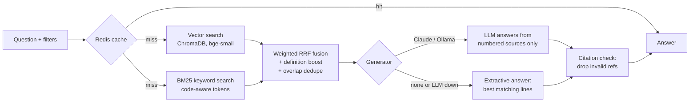
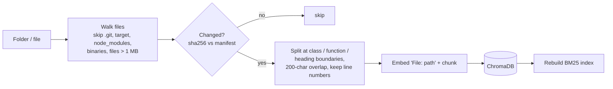

# AI-Powered Codebase & Documentation Assistant (RAG)

Ask questions about a codebase in plain English and get answers that cite the exact
files and line ranges they came from. The service indexes Java, Python, Markdown and PDF
files (plus JS/TS, SQL, YAML, Lua, ...). It searches them with **hybrid retrieval**
(semantic vectors + BM25 keywords), and has an LLM answer **only from what it found**.

Built with Python, FastAPI, ChromaDB, local ONNX embeddings, BM25, Redis and the Claude API.


## Results at a glance

**Retrieval quality.** On 22 questions about the two other internship projects
(`eval/questions.jsonl`), each with a known correct file:

| Retrieval mode | hit@4 | MRR |
|---|---|---|
| Semantic only (vectors) | 95% | 0.74 |
| Keyword only (BM25) | 77% | 0.59 |
| **Hybrid (weighted RRF + definition boost)** | **95%** | **0.78** |

Hybrid finds the right file as often as semantic search, and ranks it higher. On
identifier questions ("Where is `reserveAndEnqueue` defined?") it puts the defining file
first, even when other files only mention the name.

**Other measured behaviour:**

| Check | Result |
|---|---|
| Indexing this repository (96 files, 241 chunks, CPU only) | ~30 s first time; re-runs skip unchanged files |
| Retrieval latency per question | ~40 ms |
| Repeated question (Redis cache) | ~1 ms, no LLM call |
| 35 questions in a burst from one client | 30 answered, 5 get `429` |
| Automated tests | 38 passing |

## How a question is answered





1. **Ingestion.** Files are split along natural boundaries using language-aware splitters
   (Java, Python, Markdown, JS/TS, ...): about 1,500 characters per chunk with 200 overlapping.
   Each chunk records its exact start and end line, or the page number for PDFs, so every
   citation points somewhere real. Re-ingesting only processes files whose hash changed and
   drops chunks of deleted files.
2. **Retrieval.** The question goes to two retrievers. Each returns its top 20, and the
   lists are merged with Reciprocal Rank Fusion. Filters (file type, project) apply to both.
3. **Generation.** The top chunks go to the LLM as numbered `<source>` blocks, with a strict
   system prompt: answer only from the sources, cite them as `[n]`, say so when the answer
   isn't there, and ignore instructions found inside the sources (prompt-injection guard).
4. **Citation check.** `[n]` references to sources that don't exist are removed. Brackets
   inside code (`items[2]`) are left alone. Each source is flagged as cited or not.

## Design decisions

The brief suggested LangChain + ChromaDB + Streamlit. These are the choices I made and why:

| Decision | Why |
|---|---|
| **Hybrid search with *weighted* RRF** | Plain RRF made hybrid *worse* than vectors alone (MRR 0.61 vs 0.67), because BM25 is noisy on plain-English questions. The keyword list now counts 0.5× for prose questions and 1.5× when the question contains a code identifier (camelCase, snake_case, `call()`) |
| **Code-aware BM25 tokenizer** | `placeOrder` is indexed as `placeorder`, `place` and `order`, so both "placeOrder" and "place order" match. English stopwords are removed, otherwise long READMEs won every "how does the ..." question |
| **Definition boost** | "Where is X defined?" used to return files that only *mention* X. A chunk that declares the identifier (`def x`, `class X`, `Type x(`) now gets a bonus equal to ranking first in both lists |
| **Local embeddings** (fastembed, `BAAI/bge-small-en-v1.5`, ONNX) | No API key and no per-query cost, and code never leaves the machine for indexing. The model is baked into the Docker image, so it starts offline |
| **`File: path` header on every embedded chunk** | A method body alone often doesn't say which class it belongs to. The path carries a lot of meaning |
| **LangChain only for the text splitter** | The splitters are genuinely useful. The rest of the pipeline is a handful of small, plain Python modules that are easy to read, debug and test without framework magic |
| **FastAPI-served chat page instead of Streamlit** | One process and one port. Citations are clickable and open the exact source |
| **Three answer modes** | Claude if `ANTHROPIC_API_KEY` is set, Ollama for a free local model, otherwise an *extractive* mode that returns the best matching line of each source. If the LLM call fails, the answer falls back to extractive mode with a warning instead of an error |
| **Cache keyed on the index version** | Every ingest that changes something bumps the version, so cached answers never refer to stale code |

## Running it

### With Docker (recommended)

```bash
cd 03-rag-codebase-assistant
export ANTHROPIC_API_KEY=sk-ant-...     # optional - without it you get extractive answers
docker compose up -d --build
```

Open **http://localhost:8000**. On first start it indexes the two other projects in this
repository in the background (about 30 s). The mounted folder and what gets indexed are
configurable:

```bash
REPO_PATH=/path/to/any/repo INGEST_ON_START=. docker compose up -d
```

### Locally (Python 3.12+)

```bash
cd 03-rag-codebase-assistant
python -m venv .venv && source .venv/bin/activate
pip install -r requirements-dev.txt

python -m rag ingest .                                   # index everything under INGEST_ROOT (default: ..)
python -m rag ask "How does checkout prevent overselling?"
python -m rag ask "Where is PriceLevel reset?" -l java -k 3
python -m rag serve                                      # UI + API on http://127.0.0.1:8000
```

### Choosing the LLM

| Setting | What answers |
|---|---|
| `ANTHROPIC_API_KEY=...` | Claude (`claude-opus-5-5` by default, `CLAUDE_MODEL` to change; `CLAUDE_EFFORT` = low / medium / high). Requests opt into server-side refusal fallback (`fallbacks="default"`) |
| `OLLAMA_URL=http://localhost:11434` (+ `OLLAMA_MODEL`) | any model running in [Ollama](https://ollama.com), free and fully local |
| neither | extractive answers: the best matching line of each source, with citations |

`LLM_PROVIDER=claude|ollama|none` forces a choice. The default, `auto`, picks in the
order above.

## API

| Method | Path | Notes |
|---|---|---|
| POST | `/ask` | `{question, top_k?, languages?, project?, mode?}` → answer, sources, generator, cached, timings. Rate limited per client IP |
| POST | `/ingest` | `{path}` relative to `INGEST_ROOT`. Needs header `X-Admin-Token`; disabled when `ADMIN_TOKEN` is unset. Paths outside the root are refused |
| GET | `/stats` | files, chunks, chunks per language and project, generator, cache backend |
| GET | `/health` | liveness |
| GET | `/` | chat UI |
| GET | `/docs` | interactive OpenAPI docs |

```bash
curl -s localhost:8000/ask -H 'Content-Type: application/json' \
  -d '{"question": "How is order latency measured?", "languages": ["java"], "top_k": 3}'
```

Real response from the running container, no LLM configured (snippets shortened):

```json
{
  "answer": "No language model is configured, so here are the most relevant passages:\n\n- `LatencyTracker.java:1-31`: public class LatencyTracker { [1]\n- `OrderServer.java:16-48`: public class OrderServer { [2]\n- ...",
  "sources": [
    {
      "id": 1,
      "path": "01-HFT-matching-engine/src/com/engine/metrics/LatencyTracker.java",
      "location": "01-HFT-matching-engine/src/com/engine/metrics/LatencyTracker.java:1-31",
      "language": "java",
      "start_line": 1,
      "end_line": 31,
      "score": 0.02446,
      "snippet": "package com.engine.metrics;\n\npublic class LatencyTracker { ...",
      "cited": true
    }
  ],
  "generator": "extractive",
  "cached": false,
  "timings_ms": {"retrieval": 60.0, "generation": 0.6, "total": 60.7}
}
```

With `ANTHROPIC_API_KEY` set, `answer` is Claude's written explanation with `[n]` citations
and `generator` is `claude:claude-opus-5-5`.

## Tests and evaluation

```bash
pytest                    # 38 tests, ~3 s, no network or model download needed
python eval/run_eval.py   # retrieval eval with the real embedding model (-v prints misses)
```

| Test file | Covers |
|---|---|
| `test_chunking_and_keywords.py` | chunk text matches the reported line range exactly, full file coverage, tokenizer, identifier and definition detection |
| `test_retrieval.py` | RRF maths and weights, exact identifier lookup, definition beats mentions, file-type and project filters, each search mode |
| `test_ingest.py` | build output skipped, unchanged files skipped, changed file re-indexed with old chunks removed, deleted file removed, path traversal refused, index survives restart |
| `test_api.py` | citations checked, cache hit on a re-phrased question, cache invalidated by re-ingest, LLM failure degrades to extractive, filters, no-match skips the LLM, rate limit, admin token |
| `test_generator.py` | citation cleanup ignores code, source formatting, Claude request shape (model, fallbacks, effort), refusal and truncation handling |

Unit tests use a deterministic hashing embedder so they run offline. The eval uses the
real model.

## Configuration

| Variable | Default | |
|---|---|---|
| `INGEST_ROOT` | `..` | only paths below this can be indexed |
| `INGEST_ON_START` | – | comma-separated paths to index at startup |
| `DATA_DIR` | `data` | ChromaDB files + manifest |
| `EMBEDDING_MODEL` | `BAAI/bge-small-en-v1.5` | any fastembed model; changing it requires re-indexing |
| `CHUNK_SIZE`, `CHUNK_OVERLAP` | `1500`, `200` | characters |
| `DEFAULT_TOP_K`, `CANDIDATE_POOL` | `4`, `20` | sources per answer, candidates per retriever |
| `ANTHROPIC_API_KEY`, `CLAUDE_MODEL`, `CLAUDE_EFFORT` | –, `claude-opus-5-5`, `medium` | |
| `OLLAMA_URL`, `OLLAMA_MODEL` | –, `llama3.1` | |
| `REDIS_URL` | – | answer cache; in-memory LRU when unset |
| `CACHE_TTL_SECONDS` | `3600` | |
| `RATE_LIMIT_PER_MINUTE` | `30` | per client IP on `/ask` |
| `ADMIN_TOKEN` | – | enables `POST /ingest` |

## Project structure

```
03-rag-codebase-assistant/
├── rag/
│   ├── loader.py       walk folders, read text / PDF pages, skip junk
│   ├── chunker.py      language-aware splitting with line numbers
│   ├── embeddings.py   fastembed (real) + hashing embedder (tests)
│   ├── store.py        ChromaDB wrapper + manifest of indexed files
│   ├── keyword.py      code-aware BM25, identifier / definition detection
│   ├── retriever.py    weighted RRF, definition boost, overlap dedupe
│   ├── generator.py    Claude / Ollama / extractive, prompt, citation check
│   ├── cache.py        Redis or in-memory answer cache
│   ├── ratelimit.py    per-client token bucket
│   ├── service.py      ingest + ask orchestration
│   ├── api.py          FastAPI app
│   ├── __main__.py     CLI: ingest / ask / serve
│   └── static/         chat UI
├── tests/
├── eval/               questions.jsonl + run_eval.py
├── Dockerfile
└── docker-compose.yml
```

## Known limitations

- **Not tested against the live Claude API here.** No API key was available while building
  this. The Claude call is covered by unit tests of the request it sends (model, refusal
  fallback, effort) and of how it handles refusals and truncation. The live run should be
  checked once a key is set.
- **Answers are not streamed.** The UI waits for the full answer, which can take a few
  seconds with the LLM. Streaming over SSE would be the next step.
- **BM25 index and rate limiter are in-process.** That's fine for one instance. Several
  instances behind a load balancer would each rebuild BM25 from Chroma (consistent), but
  the rate limit would apply per instance.
- **The eval set is small (22 questions)** and was written alongside the tuning. Treat the
  numbers as a sanity check, not a benchmark.
